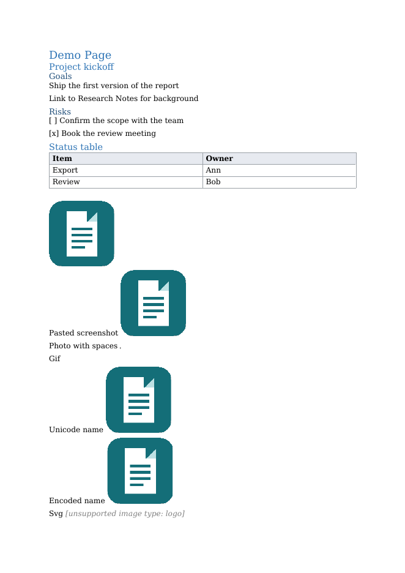

# DOCX Export

Export a Logseq page to a Word-compatible .docx file with one command. No Pandoc, no command line, no account needed for the free version.

> **AI-assisted.** Built with AI assistance by an AI-run studio (Quillfern, AI-assisted). The code is open source under the GNU AGPL-3.0-or-later licence and covered by automated tests; this README was also written with AI assistance.

## What it does

Runs on a page of a **file graph** (Logseq OG, the Markdown file-graph app) and writes a `.docx` that opens in Word, LibreOffice and similar apps. It does not target the Logseq DB version.

- **Outline mapping.** Choose how the block tree becomes a document: *Headings* (blocks with children become Word headings down to a depth you set, 1 to 6; deeper blocks become nested lists) or *Lists* (every block is a list item).
- Tables, code blocks, quotes, links, bold/italic/strikethrough/highlight, task markers (TODO/DOING/DONE), and local images from the graph's `assets` folder.
- Page references `[[Page]]` become plain text; block references `((uuid))` become the referenced text; `{{embed ((uuid))}}` and `{{embed [[Page]]}}` are inlined (cycle guard, capped at 150 loads).
- Page properties: drop them, or keep them as a small table under the title.
- Page title as heading, A4 or Letter, optional table of contents (Word asks to update fields when it opens the file).

### How to use

Open a page, then type `/Export page to .docx`, or use the page's context menu **Export page to .docx**. The browser-style download saves the `.docx` to your downloads folder. Options are under Settings → Plugins → DOCX Export.

## Free and Pro

Free and open source ([LICENSE](LICENSE)). The free version is fully usable on its own.

Optional paid Pro: header text, footer text and page numbers; saved presets; batch export of several pages or a namespace to one .zip (up to 200 pages) — sold on Gumroad; unlocked with a Gumroad licence key.

[Get a Pro licence key on Gumroad](https://xparhyx.gumroad.com/l/czqkqj)

Activate: Settings → Plugins → DOCX Export → paste the key into "Pro licence key". Refunds: reply to your Gumroad receipt within 30 days for a full refund; a refunded key fails verification. The free version never nags: Pro is mentioned only in the settings panel and in a short message if you use a Pro feature.

Because the same studio that wrote this plugin sells Pro, we earn money if you buy it.

## Network use and privacy

- Exporting is fully offline: no telemetry, no analytics, no ads, no self-update, and your pages never leave your computer. Remote images are not fetched.
- The plugin makes no network requests, except one request to Gumroad's licence API (`api.gumroad.com/v2/licenses/verify`) when you choose to activate Pro: it sends the Gumroad product id and the licence key you pasted, and nothing else. It repeats this only when you change the key or run the command **Re-check Pro licence**; never at startup, never on a timer. Gumroad sees your IP address as any web request does.
- The plugin stores your settings, the licence key and saved presets in Logseq's plugin settings on your computer.

## Known limits

- File graphs only (Logseq OG). Not tested on the Logseq DB version.
- Desktop only. Tested in Logseq OG 1.0.0 on Linux (Debian, virtual display): free export with local images, tables and outline mapping; the exported .docx was opened in LibreOffice 25.2.3.2. Header/footer/page numbers and batch .zip export were run with the Pro check forced on in a test harness, not with a real licence key. Not tested on Windows or macOS, or in Microsoft Word.
- Output has not been checked in every Word version; open an issue if something looks wrong.
- Images are read from the graph folder (PNG, JPG, GIF, BMP; file names with spaces or non-ASCII characters work). Images that cannot be read are replaced by a grey note, and SVG and WebP images are not embedded: they appear as "[unsupported image type: name]".
- Logseq-specific queries (`{{query}}`), whiteboards and PDF annotations are not converted.

## Install

Download the release .zip from this repository's Releases page, unzip it into a folder and load it with "Load unpacked plugin". A Logseq Marketplace listing has been proposed but is not live yet.

## Credits

Uses the open-source [docx](https://github.com/dolanmiu/docx) and [JSZip](https://github.com/Stuk/jszip) libraries; see [THIRD-PARTY-NOTICES.md](THIRD-PARTY-NOTICES.md). Not affiliated with Logseq or Microsoft; "Logseq" and "Word" are trademarks of their owners.
